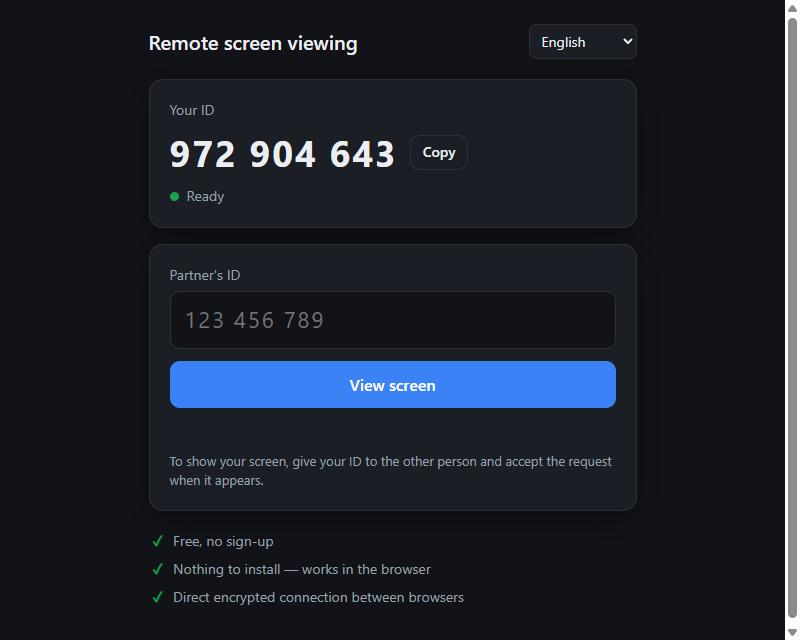

# Remote View — share your screen in the browser, no install

**Live:** https://aleksteslasmart.github.io/remote-view/

Show your screen to someone in seconds. No downloads, no accounts, no browser extensions.

## How it works

1. Open the site — you get a 9-digit ID.
2. The other person opens the same site, enters your ID and clicks **View screen**.
3. You accept the request and pick a screen, window or tab to share.

That's it. You can stop sharing at any moment.

## Features

- **Free, no sign-up** — nothing to register, nothing to install.
- **Accept-first** — nobody sees your screen until you click *Allow*.
- **Peer-to-peer and encrypted** — video goes directly between browsers over WebRTC (DTLS-SRTP).
  When a direct connection is impossible (strict NAT, corporate networks) it is relayed through a TURN server, still encrypted end to end.
- **Works on phones for viewing** — pinch to zoom, drag to pan, double-tap to zoom in, full screen.
- **15 languages** — English, Русский, Українська, Deutsch, Français, Español, Italiano, Português, Polski, Türkçe, 中文, 日本語, Latviešu, Lietuvių, Eesti. Picked automatically from your browser.
- **Share a link** — `https://aleksteslasmart.github.io/remote-view/?id=123456789` pre-fills the ID.

## Limitations

- **View only** — remote control of mouse and keyboard is not possible from a web page.
- **Sharing needs a desktop browser** (Chrome, Edge, Firefox, Safari). Phones can view, but browsers on iOS and Android don't allow sharing their screen.

## Tech

A single static page — `index.html` + `i18n.js`, hosted on GitHub Pages.

- [PeerJS](https://peerjs.com/) for signaling (PeerJS Cloud)
- WebRTC `getDisplayMedia` for screen capture
- Google STUN + [Metered](https://www.metered.ca/) TURN relay

Add `?relay=1` to the URL to force the TURN relay (useful for testing). A diagnostics line in the viewer shows the route (`direct` / `stun` / `turn`), resolution, fps and bitrate.

---

**По-русски:** бесплатный просмотр экрана в браузере без установки и регистрации. Откройте сайт, сообщите собеседнику 9-значный ID, подтвердите запрос — и он увидит ваш экран.
